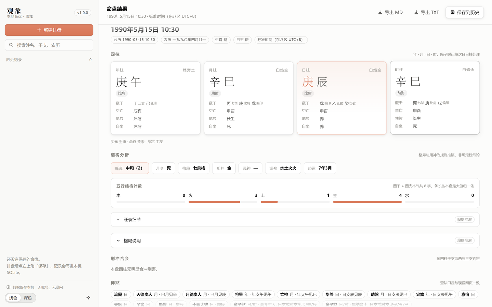

# 观象

Windows 上的四柱排盘工具。离线运行，不需要账号。



## 下载

在 [Releases](https://github.com/UnseenAnchor/guan_xiang/releases/latest) 下载 `GuanXiang.exe`，双击运行。

## 功能

- 公历、农历输入，支持闰月和晚子时
- 四柱、十神、藏干、纳音、空亡、神煞、十二长生、刑冲合会
- 大运、流年、旺衰、格局、用神，古籍参照与规则推演分开显示
- 真太阳时校正，默认关闭
- 历史记录存在本机，可搜索、改名、备注、删除
- 导出 Markdown、TXT
- 浅色、深色界面

## 数据

历史记录保存在本机：

```text
%APPDATA%\GuanXiang\guanxiang.db
```

## 许可

MIT，见 [LICENSE](LICENSE)。

仓库另含旧的网页版，用 `python web_server.py` 启动。
