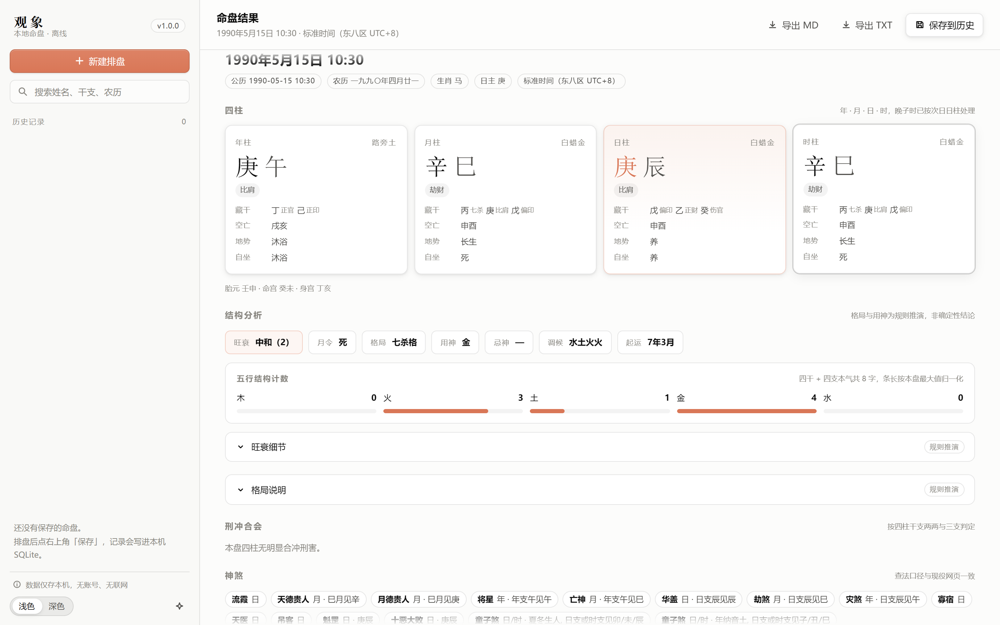
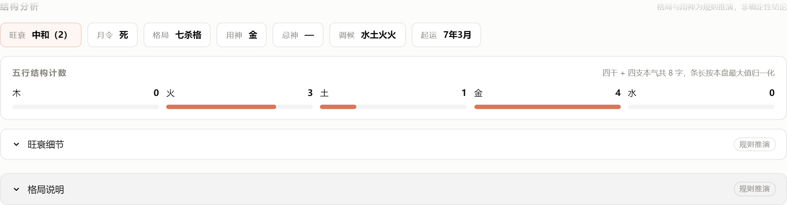
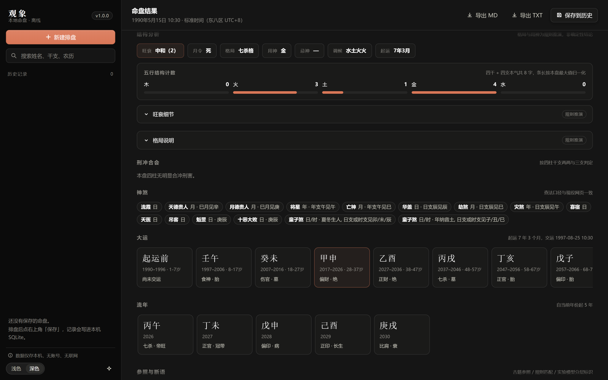

# 观象桌面版（Guan Xiang Desktop）

纯本地、免登录、完全离线运行的四柱排盘桌面客户端：**Go 后端 + 单文件 Windows EXE**，
界面按 [open-claude-ui](../../vendor/open-claude-ui)（Claude Design System，MIT，`Copyright (c) 2026 Caho1`）的设计令牌复刻。

| 项目 | 说明 |
| :--- | :--- |
| 后端 | Go 1.24（`CGO_ENABLED=0`，纯静态单文件；历法来自 `github.com/6tail/lunar-go`） |
| 存储 | 本机 SQLite（`modernc.org/sqlite` 纯 Go 驱动，无需安装数据库） |
| 界面 | 原生 HTML/CSS/JS，资源全部内嵌进 EXE，无 CDN、无外链字体 |
| 窗口 | 原生 WebView2 窗口（标准 Windows 标题栏，标题与图标取自 EXE 资源）；缺 WebView2 运行时时回退 Edge/Chrome 应用窗口 |
| 账号 | 无。无登录、无密钥、无遥测、无任何出网请求 |
| 产物 | `build/观象.exe`（约 12 MB，双击即用；资源管理器/任务栏显示品牌图标） |





## 快速开始

```powershell
# 1) 构建（首次会下载 Go 依赖）
powershell -ExecutionPolicy Bypass -File build.ps1

# 2) 双击运行
build\观象.exe
```

- 默认历史库：`%APPDATA%\GuanXiang\guanxiang.db`（可用 `--data-dir` 指定目录）
- 运行日志：同目录下 `guanxiang.log`
- 关闭窗口后约 30 秒，进程自动退出（界面心跳停止）

命令行参数：

| 参数 | 说明 |
| :--- | :--- |
| `--data-dir <dir>` | 指定数据目录（历史库、窗口配置、日志） |
| `--port <n>` | 本地服务端口，默认 `8791`；被占用时自动改用空闲端口 |
| `--serve` | 只启动本地服务，不开窗口（自动化验证用） |
| `--no-window` | 打印地址但不启动浏览器 |
| `--width/--height` | 窗口尺寸，默认 `1440×900` |

## 功能

- **排盘**：公历 / 农历（含闰月、按真实月天数联动）三段式输入，晚子时按次日日柱处理。
- **真太阳时**：出生地经度选填；开关默认关闭，**未启用时经度不会传给排盘引擎**，口径在结果中显式标注。
- **命盘内容**：四柱干支、藏干与藏干十神、十神、纳音、空亡、日主地势、自坐长生、胎元/命宫/身宫、
  五行结构计数、刑冲合会、神煞、旺衰评分、格局、用神/忌神/调候、大运与流年、
  月令断语（《穷通宝鉴》）、日主性格（《滴天髓》）、运年断语与《三命通会》参照。
- **历史**：保存/读取/重命名/备注/删除/搜索，记录写入本机 SQLite；重启后仍在。
- **导出**：本地生成 Markdown / 纯文本（`/api/history/{id}/export`）。
- **外观**：浅色 / 深色双模，跟随 open-claude-ui 的 Surface 阶梯与陶土主色。



## 架构

```
desktop/
├── main.go                 进程入口：单实例端口、本地服务、窗口启动、心跳退出
├── window_windows.go       原生 WebView2 窗口（品牌图标）、标题栏深浅同步、DPI 换算
├── rsrc_windows_amd64.syso Windows 资源：RT_GROUP_ICON #1 + 版本信息（go-winres 生成）
├── internal/bazi/          排盘引擎（Python 引擎的 Go 移植 + 内嵌知识数据）
│   ├── data/               与仓库 knowledge/*.json 逐字节一致的内嵌副本
│   ├── chart.go            输入解析、真太阳时、四柱、大运、流年、五行结构
│   ├── ganzhi.go/shensha.go/hehui.go/geju.go/analysis.go/duanyu.go
│   ├── export.go           Markdown / 纯文本导出
│   └── parity_test.go      与 Python 引擎逐字段交叉验证（80 例）
├── internal/store/         本机 SQLite 历史库（含重开持久化测试）
├── internal/api/           HTTP 接口 + 内嵌静态资源
├── ui/                     index.html / app.css / app.js / cds-theme.css / manifest.webmanifest
│   └── brand/              品牌矢量、多尺寸 PNG 与 favicon.ico（见 brand/README.md）
├── tools/gen_golden.py     生成 Python 侧黄金样本（仅验证用）
├── tools/make_brand.py     品牌矢量 → 多尺寸 PNG / ICO
├── tools/verify_ui.py      Playwright 界面取证（截图 + 断言）
└── evidence/               验证记录与截图
```

运行时只有一个进程：监听 `127.0.0.1` 的本地 HTTP 服务（仅本机回环），并在**原生 WebView2 窗口**里加载它
（`window_windows.go`，纯 Go、无 CGO；窗口图标以资源 ID `#1` 从 EXE 读取）。界面与后端同源，
因此没有 CORS、没有跨域 Token。机器缺少 WebView2 运行时时，自动回退到 Edge/Chrome 的 `--app` 窗口。

## 品牌


- 图形：陶土底 + 纸白「观象」二字，思源宋体（Noto Serif SC）第 700/800 字重，横向居中、字距收紧。
- 字形由 `tools/make_wordmark.py` 用 fontTools **转成矢量路径**写进 SVG——不在 SVG 里引用字体，换机器渲染结果一致；
  16/24px 另出一版加粗放大的 `icon-small.svg`。
- 曾用 GPT Image 2 生成字标，7 张全部存在笔画错误（「象」上部 ⺾ 与「口」黏连、「观」的「见」少笔），
  故最终以真字体排字，生图仅作探索记录（见 `evidence/logo-explorations/` 与 `evidence/glyph-check*.png`）。
- 生效位置：EXE 图标（资源管理器/任务栏/Alt-Tab）、原生窗口左上角、页面 favicon 与 Web App Manifest、空状态与「关于」。
- 深色界面下原生窗口标题栏会跟随切换（`DwmSetWindowAttribute`），不会出现"深色界面 + 白色标题栏"。
- 细节与重新生成方式见 [`ui/brand/README.md`](ui/brand/README.md)。

## 与网页版的关系

- **同源数据**：内嵌的 `ny.json / serjson.json / 月令断语 / 性格断语 / 三命通会` 直接取自仓库 `knowledge/`，
  并由 `TestEmbeddedKnowledgeMatchesRepo` 逐字节校验，防止两套数据漂移。
- **同源结果**：`parity_test.go` 用 80 个案例（60 位名人 + 10 个节气/晚子时/真太阳时边界 + 10 个补充用例）
  与 Python 引擎 `bazi.engine.build_chart` 逐字段比对：四柱、藏干、十神、纳音、空亡、地势、旺衰、
  格局、用神、神煞（顺序敏感）、刑冲合会、大运、起运、流年、断语标题、胎元/命宫/身宫、真太阳时。
- **已知的上游口径**：现役 `bazi/shensha.py` 中「天乙贵人 / 文昌贵人 / 太极贵人 / 国印贵人 / 金舆」
  五类查法把柱名当作天干查表，条件恒为空、实际从未生效。桌面端为与网页端保持一致（避免两个界面数据打架），
  同样不产出这五类，代码中保留了查表并在注释里说明；待上游修复后同步启用。

## 界面设计的出处（open-claude-ui）

界面不引入 React/Tailwind，只消费 CDS 的令牌层 `cds-theme.css`（MIT，取自上游 `code-examples/`）：

- **色彩**：陶土主色 `--cds-clay #d97757`（深色 `#cc6b49` 系）、`Surface 0-3` 微明度阶梯
  （浅色 `#f9f9f7 → #ffffff`，深色 `#0b0b0b → #20201f`）、`--cds-alpha-*` 发丝边。
- **圆角**：`--cds-radius`(8px)、`--cds-radius-composer`(12px)、`--cds-panel-radius`(10px)、胶囊 999px。
- **投影**：`--cds-shadow-composer` 双环输入终端阴影、`--cds-shadow-popover` 弹层双环投影。
- **动效**：`--cds-ease-swift/snap/expand/enter/pop` 与 `--cds-dur-fast/snap/base/sheet/slow`；
  分段控件滑块用 `--cds-ease-snap`，折叠面板用 Grid `0fr → 1fr` 的 `--cds-ease-expand`，
  按压 `active: scale(.98)`，思考态三点波浪。
- **交互守卫**：CJK 输入法合成期间（`isComposing || keyCode === 229`）不触发任何提交；
  等宽数字 `tabular-nums`；滚动边缘渐隐遮罩；`prefers-reduced-motion` 降级。
- **可访问性**：分段控件为原生 `radio` + `:focus-visible` 焦点环，历史项可键盘 `Enter/Space` 打开，
  弹层 `role="dialog"` + `Esc` 关闭，图标按钮均有 `aria-label`。

## 验证

```bash
cd desktop

# 1) Go 单元与交叉验证（104 个断言，含 80 例与 Python 引擎的逐字段比对）
go vet ./...
go test ./...

# 2) 构建产物
bash build.sh          # 或 powershell -File build.ps1

# 3) 品牌资源（改了 logo 才需要）
python tools/make_brand.py
go run github.com/tc-hib/go-winres@latest simply --arch amd64 --out rsrc --icon ui/brand/icon.ico ...

# 4) 接口冒烟（--serve 模式，仅本机）
./build/观象.exe --serve --port 8801 --data-dir .testdata

# 5) 界面取证（Playwright + 本机 Edge，截图写入 evidence/）
python tools/verify_ui.py --base http://127.0.0.1:8801 --out evidence
```

`tools/verify_ui.py` 覆盖：四柱渲染与预期一致、结构与折叠区完整、保存历史、刷新后从历史回读、
农历模式、真太阳时开关受经度约束、深浅色切换、手机断点与侧栏抽屉、**无任何外网请求**、
无登录控件、控制台无报错。结果见 `evidence/ui-verification.json` 与 `evidence/README.md`。

## 许可

本项目以 MIT 发布（见根目录 `LICENSE`）。**分发包内含第三方代码**，因此单独维护一份随包声明：

- [`legal/notices.md`](legal/notices.md)：12 个 Go 模块 + Microsoft WebView2Loader.dll + open-claude-ui 令牌 +
  内嵌知识数据的逐项版权行、许可全文与数据来源；随 EXE 内嵌，可通过本地 `/legal/notices.md` 读取。
- `go test ./legal/` 会校验该声明覆盖了所有真正链接进二进制的模块，新增依赖时忘记更新会直接失败。
- 网页端地名数据另见 [`../web/LOCATION-DATA-LICENSE.txt`](../web/LOCATION-DATA-LICENSE.txt)。

## 边界

- 仅 Windows。窗口依赖 WebView2 运行时（Windows 10/11 一般随 Edge 自带）；缺失时回退 Edge/Chrome
  应用窗口（此时任务栏图标会是浏览器图标），再缺则回退默认浏览器。
- 时区固定东八区（`Asia/Shanghai` / `UTC+08:00`），与网页端一致。
- 引擎支持 1800—2200 年；界面输入限制 1900—2099 年，与网页端一致。
- 旺衰、格局、用神、调候为规则推演，古籍为条文参照，均不构成确定性吉凶结论。
